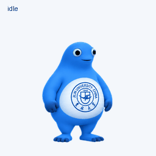
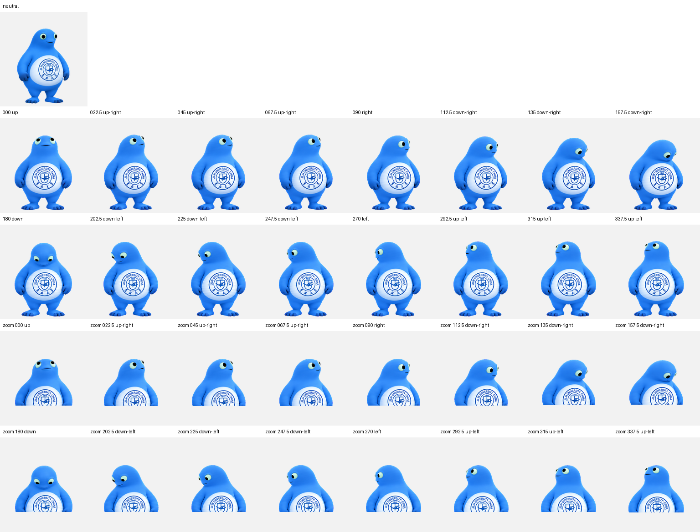

# 吉祥奶蛙 · 吉蛙

JLU Codex Pet / Jilin Blue

基于用户提供的吉林大学蓝色吉祥物参考图，制作的 ChatGPT Work 动画宠物项目。

[下载完整项目目录](jlu-codex-pet-project.zip) · [MP4 动画](all-states.mp4) · [透明精灵图](spritesheet.png)

完整素材、提示词和校验记录以压缩包保存，解压后即可取得下述目录。仓库根目录同步展示常用素材。

## 项目内容

- `assets/spritesheet.png`：经过校验的透明 PNG 精灵图。
- `assets/poses.png`：全部动作与朝向的联系表。
- `assets/look-directions.png`：十六个观察方向及中性姿势。
- `previews/`：各动作 GIF、全部动作 GIF/MP4、跳跃衔接与朝向循环。
- `source/rows/`：逐行动画原始图，可用于后续重新提取与调整。
- `source/references/`：用户提供的参考图及生成的标准外观。
- `prompts/`：生成提示词。
- `qa/`：结构、动作、朝向、连续性与独立盲审报告。
- `pet.json`：可移植的精灵图元数据。

## 精灵图规格

采用 v2 格式，尺寸 **1536 × 2288**，8 列 × 11 行，每格 **192 × 208**。
共 73 个有效帧，15 个未使用的格子保持透明。

| 行 | 状态 | 帧数 |
| --- | --- | --- |
| 0 | idle：呼吸与眨眼 | 6 |
| 1 | running-right：向右移动 | 8 |
| 2 | running-left：向左移动 | 8 |
| 3 | waving：挥手 | 4 |
| 4 | jumping：跳跃 | 5 |
| 5 | failed：失落反应 | 8 |
| 6 | waiting：等待输入 | 6 |
| 7 | running：专注思考 | 6 |
| 8 | review：检查结果 | 6 |
| 9 | 朝向 000°–157.5° | 8 |
| 10 | 朝向 180°–337.5° | 8 |

朝向从正上方 000° 开始，按顺时针以 22.5° 递增；090° 是屏幕右侧，180° 是下方，270° 是屏幕左侧。

## 制作与校验

使用 OpenAI 图像生成工具逐行生成，再通过 Pets 技能的配套脚本提取、装配、去除色键边缘并校验。左右移动分别生成，避免翻转校徽文字。

最终结构校验、质量校验和 Pets 上传预检均通过。独立盲审确认四个主要方向；112.5° 和 247.5° 的垂直分量较细微，已在带标签的顺序检查中复核并记为警告。跳跃脚部最高抬升 41 像素，落地基线差为 0。

此仓库是动画素材及制作记录项目。生成提示词已保留，但重新生成图像可能产生不同结果。QA 文件记录的是制作时的检查，并非可独立运行的测试程序。校徽和角色来自所提供的参考素材；本项目不附加开源授权。

## 使用

查看根目录的 `all-states.gif` 或下载 `all-states.mp4` 预览。
导入兼容的 Pets 工作流时，使用根目录的 `spritesheet.png`（完整项目中的 `assets/spritesheet.png`），并指定精灵图版本 2。
